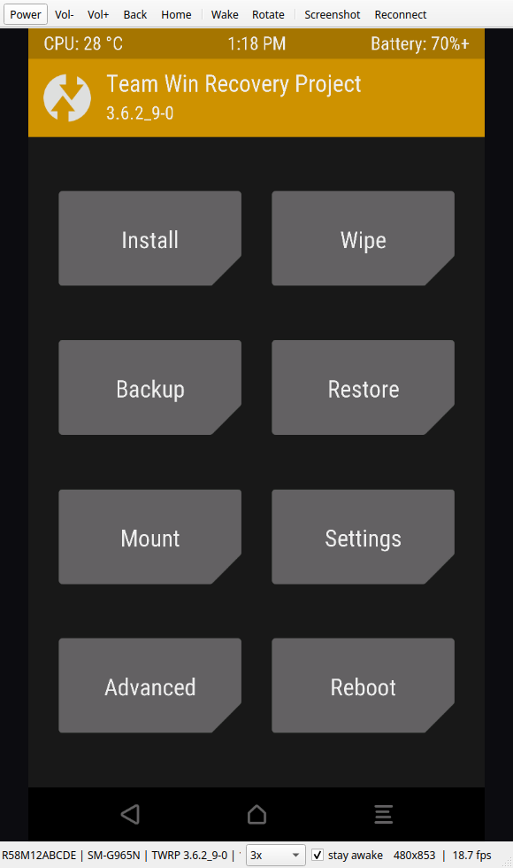

# twrpscrcpy

**Stream and control a phone running TWRP recovery — like scrcpy, but for recovery.**



## What it is
`twrpscrcpy` mirrors a phone's screen while it is booted into **TWRP Recovery** and lets you control it
with the mouse. Left click is a tap, dragging is a touch drag, and the toolbar exposes the hardware keys.
It is intentionally scrcpy-like, but scrcpy cannot work in recovery: there is no Android framework,
no `surfaceflinger`, and no `input` service. This tool talks to the raw framebuffer and evdev nodes instead.

No host root and no Android NDK are required. A tiny helper (`fbstream`) is pushed to the phone on every
connection because `/tmp` is a tmpfs that is wiped on reboot.

Tested on a **Samsung SM-G965N (crownlte)** running **TWRP 3.6.2_9-0**. It should work on other TWRP builds
that expose a readable framebuffer and writable evdev input devices.

## Requirements
- **Windows 10/11, Linux, or macOS** (Intel or Apple Silicon). The phone helper is an ARM Linux binary, so the host OS only needs Python and adb.
- Python 3.10+ when running from source, or use a prebuilt executable from the **Releases** page (no Python needed).
- `PySide6` and `numpy`. The prebuilt executables bundle them; from source, `pip install .` installs
  them automatically. On Arch you can also use `sudo pacman -S pyside6 python-numpy`.
- `adb` on `PATH`:
  - Linux: your package manager (`sudo apt install adb`, `sudo pacman -S android-tools`).
  - macOS: `brew install android-platform-tools`.
  - Windows: [Android platform-tools](https://developer.android.com/tools/releases/platform-tools) or Android Studio. The app also checks `ANDROID_HOME`, `%LOCALAPPDATA%\Android\Sdk`, and `~/Library/Android/sdk`.
- The phone connected in TWRP with ADB enabled (TWRP enables it by default).

## Install and quick start
**From Releases:** download `twrpscrcpy-windows-x86_64.zip`, `twrpscrcpy-linux-x86_64.zip`, or
`twrpscrcpy-macos.zip`. On Windows and Linux, unpack it and run `twrpscrcpy`; on macOS, open `twrpscrcpy.app`.

**From source:**
```bash
git clone https://github.com/Malek-Haroun512/twrpscrcpy.git
cd twrpscrcpy
python3 -m venv .venv
source .venv/bin/activate        # fish: source .venv/bin/activate.fish
python -m pip install .
twrpscrcpy
```
On Windows:
```bat
py -3 -m venv .venv
.venv\Scripts\activate
py -3 -m pip install .
twrpscrcpy
```
Most Linux distributions mark the system Python as externally managed (PEP 668), so installing into
a virtual environment as above is the reliable option. If `python3 -m pip` is missing, the virtual
environment still bootstraps its own pip.

If you already have `PySide6` and `numpy` (for example from
`sudo pacman -S pyside6 python-numpy` on Arch), you can run without installing anything:
```bash
./run.sh            # Linux / macOS
run.bat             # Windows
python3 -m twrpscrcpy
```

> **macOS:** if Gatekeeper blocks the unsigned app, right-click it and choose **Open**.
> **Windows:** SmartScreen may warn; choose **More info → Run anyway**.

## Options
```bash
twrpscrcpy --version           # print the version
twrpscrcpy --list              # list connected devices and exit
twrpscrcpy --serial <SERIAL>   # pick one device when several are attached
twrpscrcpy --scale 2           # capture downscale: 1 = native, 4 = fastest (default 3)
twrpscrcpy --fps 20            # capture frame-rate cap
twrpscrcpy --touch-max 4095x4095  # manual touch calibration (rarely needed)
```

## Controls
| Input | Action |
| --- | --- |
| Left click | Tap |
| Left drag | Touch drag / scroll |
| Mouse wheel | Scroll up/down |
| Right click or `Esc` | Back key |
| `Ctrl+S` | Save a PNG screenshot |
| `F5` | Restart the capture stream |
| `F11` | Fullscreen |

Toolbar: **Power / Vol- / Vol+ / Back / Home**, **Wake** (wake the panel and dismiss TWRP's lock screen),
**Rotate**, **Screenshot**, **Reconnect**. The status bar has the quality selector, a **stay awake** checkbox,
device/fps information.

## TWRP screen timeout
TWRP blanks the panel after **60 seconds** without input and shows a *Swipe to Unlock* bar.
- **stay awake** (on by default) taps the status bar every 15 seconds to keep the timeout from firing.
- On startup, if the panel is off or the unlock bar is showing, the app presses Power and drags the slider automatically.
- If the lock screen appears anyway, it is recognised from the rendered frame and dismissed automatically.
- The **Wake** button retries this at any time.

> TWRP's unlock slider ignores fast flings. The app uses a deliberately slow drag (~1.5 s), which is what
> makes unlocking reliable.

## Performance
Measured on the SM-G965N at 1440×2560:

| `--scale` | Streamed size | Approx. fps |
| --- | --- | --- |
| 1 (native) | 1440×2560 | ~3 fps |
| 2 | 720×1280 | ~10 fps |
| 3 (default) | 480×853 | ~19 fps |

Reading a full frame over USB is the bottleneck, not encoding. Use `--scale 1` when you need to read small
text. Values above 3 reduce quality further with little extra speed.

## How it works
1. `adb exec-out` starts `fbstream` on the device.
2. The helper `mmap`s `/dev/graphics/fb0`, picks the active buffer via `vi.yoffset`, downscales it,
   compresses it as RGB565 RLE, and writes it to stdout with a 32-byte header (`TWF1`) plus keepalive
   packets (`TWF2`).
3. The host decodes the frame and renders it with Qt.
4. Touches and key presses are injected by writing raw `struct input_event` records to `/dev/input/event*`.
   On the Samsung touch controller this works without `sendevent` or `uinput`, provided the
   `ABS_MT_CUSTOM` flag and pressure values are set (the helper's `--inject` mode does this).
   Each key goes to the node that actually advertises it (BACK lives on `sec_touchkey`, HOME is
   `KEY_HOMEPAGE` 172 on `gpio_keys`), every gesture starts with a release to clear phantom contacts,
   and the helper reopens the input node if the panel was suspended mid-write.

## Building the device helper
No Android NDK is needed. `clang` + `lld` produce a freestanding, statically linked binary that uses raw syscalls:
```bash
cd native
./build.sh          # Linux / macOS
```
On Windows with LLVM (`winget install LLVM.LLVM`):
```powershell
cd native
.\build.ps1
```
This produces `twrpscrcpy/bin/fbstream-arm64` and `fbstream-arm` (armv7). Prebuilt binaries are committed to the
repository, so normal users and CI do not need a cross compiler. Restart the app and the matching binary is pushed automatically.

## Development and tests
```bash
python3 -m pip install -e ".[dev]"
python3 -m pytest -q
```
The tests force Qt's `offscreen` backend, so they run headless. CI runs them on Linux, Windows, and macOS
for every push.

## Releasing
The repository ships with a release workflow triggered by a `v*` tag. After the first push:
```bash
git tag -a v1.0.0 -m "twrpscrcpy 1.0.0"
git push origin v1.0.0
```
GitHub Actions builds the wheel/sdist and PyInstaller executables for all three operating systems and attaches
them to the release.

## Troubleshooting
- **No device**: make sure the phone is in TWRP and visible in `adb devices`.
- **Black screen / capture error**: check `adb shell ls -l /dev/graphics/fb0`. The tool also tries `/dev/fb0`.
- **Touch lands in the wrong place**: read the touchscreen ranges from
  `adb shell cat /proc/bus/input/devices` (the `ABS_MT_POSITION_X/Y` maxima) and pass `--touch-max XxY`.
- **Screen stays locked**: press **Wake**. If it persists, toggle **stay awake** off and on again.
- **`adb` not found on Windows**: add `platform-tools` to `PATH`, or pass `--adb "C:\path\to\adb.exe"`.
- **Back to Android**: run `adb reboot`, or use TWRP's Reboot menu when you are done.

## Project layout
```
run.sh / run.bat           launchers for Linux/macOS and Windows
pyproject.toml             Python package and the `twrpscrcpy` entry point
requirements.txt           dependencies for a manual install
native/fbstream.c          phone helper: capture + event injection
native/build.sh            arm64 + arm build without the NDK (Linux/macOS)
native/build.ps1           the same build on Windows with LLVM
tests/                     headless pytest suite
packaging/                 PyInstaller recipe for release executables
.github/workflows/         three-OS CI and release builds
scripts/publish.sh         publish the repository to GitHub
twrpscrcpy/__main__.py     command line entry point
twrpscrcpy/adb.py          adb wrapper and adb discovery
twrpscrcpy/device.py       properties, framebuffer, and input discovery
twrpscrcpy/capture.py      capture thread and RLE decoding
twrpscrcpy/input.py        touch, keys, and gestures
twrpscrcpy/ui.py           Qt interface
twrpscrcpy/bin/            prebuilt phone helpers
```
